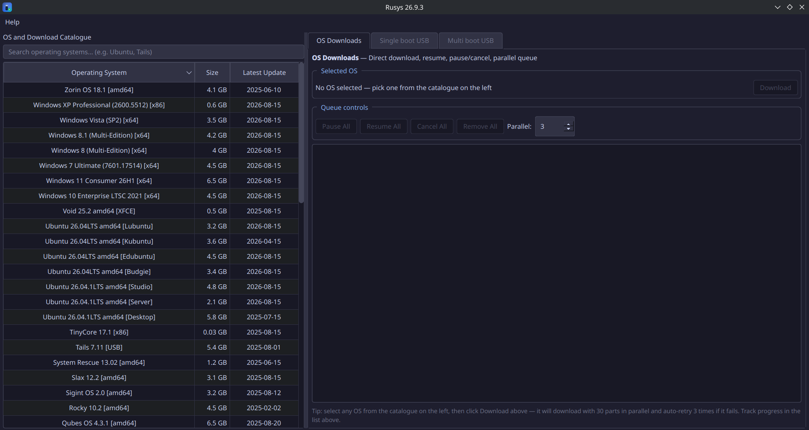
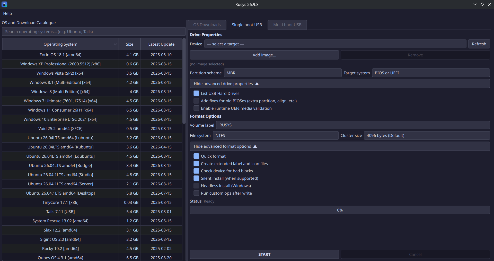
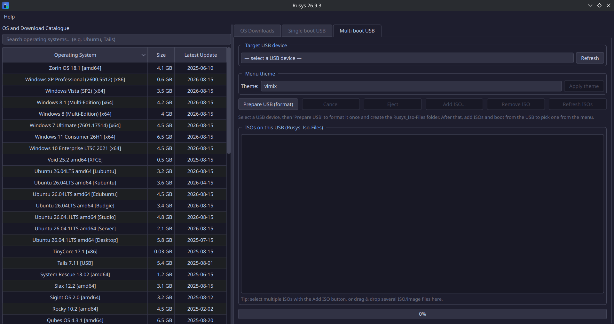
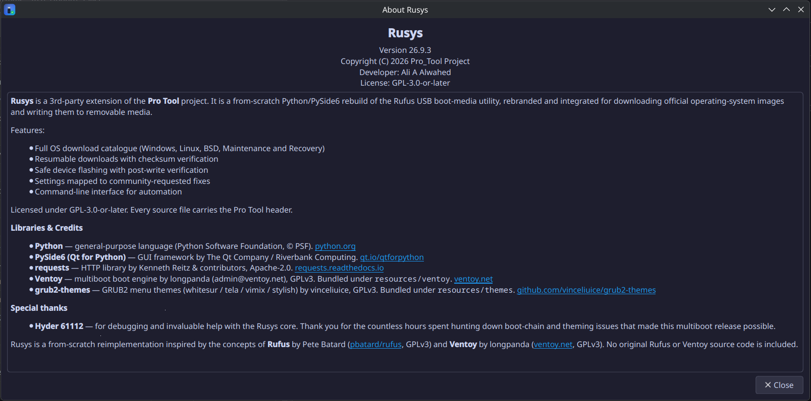

<div align="center">


# 🔥 Rusys — USB Boot Media & Ventoy Multiboot Utility

**A Python/PySide6 rebuild of the Rufus USB boot-media utility — rebranded, cross-platform, and packed with features.**

[](LICENSE.txt)
[](pyproject.toml)
[](requirements.txt)
[](rusys/__init__.py)
[](rusys/core/flasher.py)
[](Rusys.exe.manifest)

[](rusys/data/os_catalog.py)
[](rusys/core/multiboot.py)
[](rusys/ui/main_window.py)
[](https://github.com/Ali-A-Alwahed/Rusys)

---

</div>

## ⬇️ Download

> **Latest Release: v26.10.14** — [View on GitHub](https://github.com/Ali-A-Alwahed/Rusys/releases/tag/v26.10.14)

| Platform | File | Download |
|----------|------|----------|
| 🐧 Linux (standalone) | `Rusys` | [⬇️ Download](https://github.com/Ali-A-Alwahed/Rusys/releases/download/v26.10.14/Rusys) |
| 🐧 Debian/Ubuntu | `Rusys.deb` | [⬇️ Download](https://github.com/Ali-A-Alwahed/Rusys/releases/download/v26.10.14/Rusys.deb) |
| 🐧 Fedora/RHEL | `Rusys.rpm` | [⬇️ Download](https://github.com/Ali-A-Alwahed/Rusys/releases/download/v26.10.14/Rusys.rpm) |
| 🪟 Windows | `Rusys.exe` | [⬇️ Download](https://github.com/Ali-A-Alwahed/Rusys/releases/download/v26.10.14/Rusys.exe) |

### Linux Installation
```bash
# Debian/Ubuntu
sudo dpkg -i Rusys.deb

# Fedora/RHEL
sudo rpm -i Rusys.rpm

# Standalone (any Linux)
chmod +x Rusys && ./Rusys
```

### Windows
Just download and run `Rusys.exe` — no installation required.

---

## 📸 Screenshots

<p align="center">
  
  
</p>

<p align="center">
  
  
</p>

---

## ✨ Features

### 🌐 OS Download Catalog — 78 ISOs
- **Windows** — Windows 11, 10, Insider, Server (official Microsoft pages)
- **Linux** — 44 distributions: Ubuntu, Fedora, Debian, Arch, Mint, Kali, and more
- **Unix / BSD** — FreeBSD (direct ISO), OpenBSD, NetBSD, DragonFly BSD, GhostBSD, pfSense, OPNsense
- **Maintenance and Recovery** — SystemRescue, GParted, Clonezilla, Hiren's BootCD, and more
- Direct single-click downloads with resumable HTTP 206 support
- Sortable spreadsheet view with name, size and latest-update date (full download link in the row tooltip)

### 📥 Built-in Download Manager
- CDN cookie session support for os.click, SourceForge, and other redirect-based services
- Resumable downloads with proper `Referer` and `User-Agent` headers
- Queue controls: **Pause All / Resume All / Cancel All / Remove All**
- SHA-256 checksum verification on every download

### 💾 Single Boot USB
- Write any ISO/IMG/DD image directly to a USB device
- **Safe device flashing** with post-write verification
- **Single-prompt privilege escalation** via `pkexec`
- USB hotplug detection with 3-second auto-refresh

### 🔀 Ventoy-Powered Multiboot USB
- Installs the real upstream **Ventoy** boot chain onto a USB stick
- Simply **copy ISOs** to the USB — no re-imaging
- **4 themed GRUB2 menus**: WhiteSur, Tela, Vimix, Stylish
- Secure Boot capable

### 🎨 Beautiful Dark UI
- **Catppuccin Mocha** inspired dark palette
- Persistent window geometry and settings

### 🖥️ Command-Line Interface
```bash
rusys --gui                                    # Launch the graphical interface
rusys --download "Linux/Ubuntu 26.04.1LTS amd64 [Desktop]" --dir ~/iso   # Download an ISO
rusys --image ~/iso/ubuntu.iso --device /dev/sdb --verify  # Flash to USB
rusys --check ~/iso/ubuntu.iso --sha256 <hash> # Verify checksum only
rusys --version                                # Print version
```

---

## 🚀 Quick Start

### Prerequisites
- **Python ≥ 3.10** (< 3.16)
- **PySide6 ≥ 6.12** (< 6.13)
- **requests ≥ 2.34.2** — required to clear CVE-2026-25645 and CVE-2024-47081

### Installation

```bash
# Clone the repository
git clone https://github.com/Ali-A-Alwahed/Rusys.git
cd Rusys

# Install dependencies
pip install -r requirements.txt

# Launch the GUI
python -m rusys --gui
```

---

## 📁 Project Layout

```
Rusys/
├── rusys/                     # Main Python package
│   ├── core/                  # Core engine
│   │   ├── downloader.py      # HTTP download engine with CDN cookie support
│   │   ├── flasher.py         # Image flashing engine
│   │   ├── devices.py         # USB device enumeration
│   │   ├── checksum.py        # SHA-256 verification
│   │   ├── multiboot.py       # Ventoy multiboot engine
│   │   ├── settings.py        # Persistent settings
│   │   ├── logger.py           # Thread-safe logging
│   │   ├── iso.py              # ISO 9660 inspection
│   │   ├── iso_resolver.py     # Cookie-aware URL resolution
│   │   ├── multipart_downloader.py # IDM-style parallel engine
│   │   ├── flash_helpers.py    # Secure Boot advisory
│   │   └── privileges.py       # pkexec/udev privilege management
│   ├── data/                  # OS catalog
│   │   └── os_catalog.py      # Windows/Linux/Unix/Recovery catalogue
│   └── ui/                    # PySide6 GUI
│       ├── main_window.py     # Main application window
│       ├── about_dialog.py    # About dialog
│       ├── catalog_widget.py  # OS catalog browser
│       ├── os_downloads_widget.py # Download-manager tab
│       ├── settings_dialog.py  # Settings
│       ├── download_dialog.py  # Single-download progress
│       └── worker.py           # QThread worker
├── resources/                 # Icons, themes, screenshots
├── docs/                      # Documentation
├── pyproject.toml             # Build configuration
├── LICENSE.txt                # GPL-3.0-or-later
├── THIRD_PARTY_NOTICES.md     # Bundled Rufus / Ventoy / grub2-themes notices
└── README.md                  # This file
```

---

## ⌨️ Keyboard Shortcuts

| Shortcut | Action |
|----------|--------|
| `F5` | Refresh USB devices |
| `Ctrl+S` | Open Settings |
| `Ctrl+Q` | Quit |

---

## 🤝 Special Thanks

- **Hyder 61112** — Debugging and help with the Rusys core
- **[pbatard/rufus](https://github.com/pbatard/rufus)** — The original Rufus project
- **[longpanda/Ventoy](https://github.com/ventoy/Ventoy)** — The Ventoy multiboot backend
- **[vinceliuice/grub2-themes](https://github.com/vinceliuice/grub2-themes)** — GRUB2 theme collection

---

## 📜 License

Rusys is free software: you can redistribute it and/or modify it under the
terms of the **GNU General Public License v3.0 or later**, as published by the
Free Software Foundation.

- Full license text: [`LICENSE.txt`](LICENSE.txt)
- Bundled third-party notices: [`THIRD_PARTY_NOTICES.md`](THIRD_PARTY_NOTICES.md)

```
Rusys — USB Boot Media & Ventoy Multiboot Utility
Copyright (C) 2026 Pro_Tool Project
Developer: Ali A Alwahed
Licensed under GPL-3.0-or-later
```

### Why GPL-3.0-or-later?

Rusys redistributes GPL-3.0 software inside `resources/`: the **Rufus**
reference sources (4.15), the **Ventoy** 1.1.17 binaries that power multiboot,
and the **grub2-themes** assets. Distributing GPL-3.0 works requires the
combined work to be GPL-3.0-compatible, so Rusys is licensed GPL-3.0-or-later.

> **Note on the previous license.** Releases up to and including 26.9.9 were
> published under a custom permissive license ("LGPT v1.0"). That combination
> was incompatible with the bundled GPL-3.0 components and has been corrected
> as of **26.10.14**. Releases ≤ 26.9.9 remain available in the Releases page
> for historical reference.

### Security

Runtime dependencies are pinned to versions with no known CVEs:

| Package | Minimum | Advisories cleared |
|---|---|---|
| `requests` | `>=2.34.2` | CVE-2026-25645, CVE-2024-47081, CVE-2024-35195, CVE-2014-1829 |
| `PySide6` | `>=6.12,<6.13` | — |
| `setuptools` (build) | `>=83.0.0` | PYSEC-2026-3447 |

Verify at any time with `pip-audit -r requirements.txt`.

---

## 🔗 Links

- 📖 [Integration API Documentation](docs/integration_api.md)
- 🔒 [Security Policy](SECURITY.md)
- 📋 [Changelog](docs/CHANGELOG.md)
- 🐛 [Report an Issue](https://github.com/Ali-A-Alwahed/Rusys/issues)
- 💬 [Discussions](https://github.com/Ali-A-Alwahed/Rusys/discussions)

---

<div align="center">

**Made with ❤️ by [Ali A Alwahed](https://github.com/Ali-A-Alwahed)**

⭐ If you find Rusys useful, please consider giving it a star!

</div>
